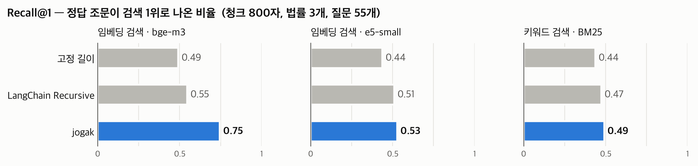

# jogak (조각)

한국어 **규정·법령·공문서의 구조**(장·조·항·호·목, `1.` → `가.` → `1)` → `가)`, `□` → `○` → `-`)를 인식해서, 조문이 중간에 잘리지 않게 RAG용 청크를 만드는 Python 라이브러리입니다. 각 청크에는 `제2장 보안 조직 > 제4조(정보보호책임자)` 같은 상위 경로가 붙습니다. 기본 설치는 의존성이 없습니다.

```python
from jogak import Chunker

chunker = Chunker(max_size=500)
for c in chunker.chunk(text, title="정보보안 관리 규정"):
    print(c.context)  # 정보보안 관리 규정 > 제2장 보안 조직 > 제4조(정보보호책임자)
    print(c.text)  # ② 정보보호책임자는 다음 각 호의 업무를 수행한다. 1. ... 2. ...
    vector_db.add(c.embed_text, metadata={"path": c.path, "start": c.start, "end": c.end})
```

## 왜 필요한가

범용 분할기는 글자 수나 문장만 보고 자르기 때문에, 한국 규정 문서에서 이런 일이 생깁니다.

- `② 정보보호책임자는 다음 각 호의 업무를 수행한다.`와 그 아래 `1.` `2.` `3.`이 서로 다른 청크로 갈라집니다.
- `3. 보안사고의 조사 및 대응`만 있는 청크는 **어느 조문의 몇 항인지** 알 수 없어서 검색되지 않거나, 답변에서 근거를 댈 수 없습니다.

jogak은 문서를 구조 트리로 파싱한 뒤 크기 안에서 최대한 큰 구조 단위로 묶고, 잘라야 할 때는 상위 경로를 청크에 붙입니다.

실제 법률 3개와 질문 55개로 임베딩 검색(bge-m3)을 시험해 보니, 800자 청크 기준 Recall@1이 LangChain `RecursiveCharacterTextSplitter`의 0.55에서 0.75로 올랐습니다. 키워드 검색(BM25)에서는 차이가 작았습니다. 자세한 내용은 [벤치마크](#벤치마크)에 있습니다.



## 설치

```bash
pip install jogak
pip install "jogak[kiwi]"        # Kiwi 형태소 분석기로 문장 분리
pip install "jogak[tiktoken]"    # 토큰 수 기준으로 크기 제한
pip install "jogak[langchain]"   # LangChain TextSplitter 연동
```

Python 3.11 이상이 필요합니다.

## 예시

```text
$ jogak 정보보안규정.txt --max-size 80

── #10 [제2장 보안 조직] (53자, 538-591)
제4조(정보보호책임자) ① 대표이사는 정보보호 업무를 총괄하는 정보보호책임자를 지정하여야 한다.

── #11 [제2장 보안 조직 > 제4조(정보보호책임자)] (66자, 592-658)
② 정보보호책임자는 다음 각 호의 업무를 수행한다.
1. 정보보안 정책의 수립 및 시행
2. 정보보안 교육 계획의 수립

── #12 [제2장 보안 조직 > 제4조(정보보호책임자) > ② 정보보호책임자는 다음 각 호의 업무를…] (16자, 659-675)
3. 보안사고의 조사 및 대응
```

구조가 제대로 인식됐는지는 `--tree`로 확인할 수 있습니다.

```text
$ jogak 정보보안규정.txt --tree
제1장 총칙
  제1조(목적)  이 규정은 회사의 정보자산을 보호하고 …
  제2조(정의)  이 규정에서 사용하는 용어의 뜻은 다음과 같다.
    1.  "정보자산"이란 회사가 보유하거나 관리하는 …
    2.  "개인정보"란 살아 있는 개인에 관한 정보로서 …
      가.  성명, 주민등록번호 및 영상 등을 통하여 …
```

## 인식하는 구조

| 구분 | 예시 |
|---|---|
| 법령 제목 단위 | `제1편`, `제1장 총칙`, `제1절`, `제1관`, `제1조(목적)`, `제4조의2(…)`, `제5조 삭제`, `부칙 <…>`, `[별표 1]` |
| 법령 항·호·목 | `①` → `1.` → `가.` (조문 제목과 같은 줄에서 시작하는 `제3조(적용 범위) ① …`도 인식) |
| 공문서 항목 기호 | `1.` → `가.` → `1)` → `가)` → `(1)` → `(가)` → `①` → `㉮` |
| 보고서 글머리표 | `□` → `○` → `-` → `·` (그 밖에 `■ ● ◎ ◇ ◆ ▶ ▷ • ㅇ ※ *`) |
| 마크다운 | `#` 제목, `-` `*` `1.` 목록 |

문서 종류를 지정할 필요는 없습니다. 항목 기호는 **나타나는 순서**로 계층을 정합니다. 처음 보는 기호는 한 단계 아래로, 이미 나온 기호는 그 단계의 다음 항목으로 봅니다. 그래서 법령의 `① → 1. → 가.`와 공문서의 `1. → 가. → 1)`를 같은 방식으로 처리합니다.

본문 속 인용(`제3조에 따라`, `제3조제1항`)이나 날짜(`2024. 1. 1.`), 소수(`1.5배`)는 구조로 오인하지 않도록 걸러냅니다. 새 목록은 첫 번호(`1`, `가`, `①`)로 시작할 때만 목록으로 인정합니다.

## 사용법

### 크기 단위

`max_size`의 단위는 `length_fn`이 정합니다. 기본은 글자 수이고, 임베딩 모델의 토큰 수에 맞추려면 토크나이저를 넘기세요.

```python
from jogak import Chunker, tiktoken_length, hf_length

Chunker(500, length_fn=tiktoken_length("cl100k_base"))
Chunker(500, length_fn=hf_length("BAAI/bge-m3"))  # pip install "jogak[hf]"
```

### 묶기 방식

```python
Chunker(800)  # 크기 안에서 이웃한 조문·항목을 최대한 묶음 (기본)
Chunker(800, merge=False)  # 조문(장·조 등 제목 단위)마다 따로. 조문 안의 항·호는 함께 둠
```

`merge=False`는 "제몇조에 뭐라고 되어 있어?" 같이 조문 단위로 인용해야 하는 경우에 좋습니다.

### 청크 정보

| 속성 | 내용 |
|---|---|
| `text` | 원문 그대로의 본문 (`source[start:end]`와 같음) |
| `start`, `end` | 원문에서의 위치. 하이라이트나 출처 표시에 사용 |
| `path` | 상위 구조 튜플 |
| `context` | `path`를 ` > `로 이은 문자열 |
| `embed_text` | `context` + 줄바꿈 + `text`. 임베딩할 때 쓰면 검색에 상위 구조가 반영됨 |

### 긴 조문

구조 단위 하나가 `max_size`보다 크면 문장 단위로 나눕니다. 기본 분리기는 정규식 기반이고, 종결 어미 처리가 더 정확한 Kiwi를 쓸 수도 있습니다. 문장 하나도 너무 길면 공백 위치에서 자릅니다.

```python
Chunker(500, sentence_splitter="kiwi")
```

### 구조 트리만 쓰기

```python
from jogak import parse

root = parse(text)
for node in root.walk():
    print(node.kind, node.label, text[node.start : node.end][:30])
```

### LangChain

```python
from jogak.langchain import JogakTextSplitter

splitter = JogakTextSplitter(max_size=500)
docs = splitter.create_documents([text], metadatas=[{"source": "정보보안규정.txt"}])
# docs[0].metadata == {"source": ..., "jogak_path": [...], "start_index": ..., "end_index": ...}
```

## 벤치마크

실제 법률 3개(개인정보 보호법, 근로기준법, 주택임대차보호법, 약 17만 자)와 질문 55개로 검색 성능을 쟀습니다. 질문은 "전입신고하고 이사 들어가면 대항력은 언제부터 생기나요?"처럼 일상 표현으로 썼고, 질문마다 정답이 되는 조문 속 구절을 하나씩 정해 두었습니다.

- 세 법률을 방식별로 잘라 한 색인에 넣고 검색합니다. 비교 대상은 고정 길이 분할과 LangChain `RecursiveCharacterTextSplitter`이며, 둘 다 10% 겹침을 둡니다.
- 정답 구절을 통째로 담은 청크가 상위 k개 안에 있으면 맞힌 것으로 칩니다.
- **R@2,000자**: 상위 청크를 2,000자까지만 LLM에 넣는다고 보고 그 안에서 맞힌 비율입니다. 방식마다 청크 길이가 달라서, 같은 컨텍스트 예산으로 맞춰 비교하려고 넣었습니다.
- **경계 시작**: 청크가 조·항·호 등 구조 경계에서 시작하는 비율입니다.

### 임베딩 검색 (BAAI/bge-m3)

| max_size 400자 | 평균 길이 | 경계 시작 | R@1 | R@5 | MRR@10 | R@2,000자 |
|---|---:|---:|---:|---:|---:|---:|
| 고정 길이 | 399 | 4% | 0.56 | 0.87 | 0.697 | 0.87 |
| LangChain Recursive | 317 | 93% | 0.67 | 0.85 | 0.756 | 0.87 |
| **jogak** | 290 | 97% | **0.78** | **0.95** | **0.857** | **0.95** |
| jogak (경로 문맥 없이) | 261 | 97% | 0.78 | 0.93 | 0.837 | 0.95 |

| max_size 800자 | 평균 길이 | 경계 시작 | R@1 | R@5 | MRR@10 | R@2,000자 |
|---|---:|---:|---:|---:|---:|---:|
| 고정 길이 | 794 | 3% | 0.49 | 0.85 | 0.655 | 0.71 |
| LangChain Recursive | 702 | 93% | 0.55 | 0.89 | 0.696 | 0.76 |
| **jogak** | 550 | 98% | **0.75** | **0.96** | **0.830** | **0.89** |
| jogak (경로 문맥 없이) | 529 | 98% | 0.76 | 0.96 | 0.842 | 0.89 |

더 작은 모델인 `intfloat/multilingual-e5-small`에서도 방향은 같습니다. 400자 기준 R@1은 고정 길이 0.38, LangChain 0.36, jogak 0.55입니다.

### 키워드 검색 (BM25 + Kiwi 형태소)

| max_size 400자 | R@1 | R@5 | MRR@10 | R@2,000자 |
|---|---:|---:|---:|---:|
| 고정 길이 | 0.29 | 0.65 | 0.447 | 0.65 |
| LangChain Recursive | 0.35 | 0.65 | 0.485 | 0.69 |
| **jogak** | **0.38** | **0.73** | **0.503** | **0.75** |

### 결과 읽기

- **임베딩 검색에서 차이가 큽니다.** bge-m3, 800자 기준으로 R@1이 LangChain 0.55에서 jogak 0.75로 올랐습니다. 이는 질문 11개 차이입니다.
- **유의성:** 질문별 짝 비교(McNemar 정확 검정)에서 유의한 차이가 나온 조건은 두 가지입니다.
  - bge-m3 800자 R@1: jogak만 맞힌 질문 15개, LangChain만 맞힌 질문 4개 (p=0.019)
  - e5-small 400자 R@1: jogak만 맞힌 질문 12개, LangChain만 맞힌 질문 2개 (p=0.013)
- **나머지 조건:** 임베딩 검색 12개 조건(모델 2개 × 크기 3개 × R@1·R@5) 모두에서 jogak이 앞서거나 같았지만, 나머지는 p≥0.05입니다. 여러 조건을 비교한 데 따른 다중 비교 보정은 하지 않았습니다.
- **BM25에서는 차이가 작습니다.** LangChain과 질문 2~4개 차이로, 유의하지 않습니다. 키워드 일치에는 청크가 의미 단위로 깔끔하게 잘렸는지가 덜 중요하기 때문으로 보입니다.
- **효과는 주로 경계에서 나옵니다.** 경로 문맥(`제2장 > 제15조(...)`)을 빼도 성능이 거의 그대로입니다. 경로 문맥은 작은 청크(200자)에서만 뚜렷하게 도움이 되었습니다(bge-m3 R@1 0.60 → 0.69). 성능 향상은 대부분 여러 조문이 한 청크에 섞이지 않게 자른 데서 옵니다.
- **청크 길이만의 효과는 아닙니다.** 400자 기준으로 LangChain(평균 317자)과 jogak(290자)의 청크 길이는 비슷한데도 R@1 차이가 큽니다.
- **고정 길이와의 비교:** 고정 길이 분할은 청크의 96% 이상이 문장 중간에서 시작하며, 모든 검색 방식에서 가장 낮습니다.
- **한계:** 이 벤치마크는 법률 3개와 질문 55개(질문은 직접 작성)로 이루어진 작은 시험입니다. 다른 문서나 질문에서는 결과가 달라질 수 있습니다.

```bash
pip install -e ".[kiwi,langchain]"
python benchmark/run.py --json benchmark/results/bm25_kiwi.json  # Kiwi 형태소 BM25, max_size 200·400·800
python benchmark/run.py --tokenizer bigram  # 문자 bigram BM25

pip install sentence-transformers
python benchmark/run.py --dense BAAI/bge-m3 --json benchmark/results/bge-m3.json
python benchmark/run.py --dense intfloat/multilingual-e5-small --json benchmark/results/multilingual-e5-small.json

pip install matplotlib
python benchmark/plot.py  # benchmark/results/*.json → docs/benchmark.png
```

데이터는 [legalize-kr](https://github.com/legalize-kr/legalize-kr)의 마크다운을 [`benchmark/prepare_data.py`](benchmark/prepare_data.py)로 법제처 웹사이트 복사본과 같은 일반 텍스트로 바꾼 것입니다. 법령 본문은 저작권법 제7조에 따라 보호 대상이 아닙니다. 질문과 정답 구절은 [`benchmark/questions.jsonl`](benchmark/questions.jsonl)에 있고, 실행할 때마다 정답 구절이 원문에 정확히 한 번 나오는지 먼저 확인합니다.

## 한계

- 줄 머리의 기호로 구조를 판단하므로, 입력은 줄바꿈이 살아 있는 텍스트여야 합니다. PDF에서 뽑은 텍스트처럼 줄이 뭉개져 있으면 구조를 잘 찾지 못합니다.
- HWP, PDF, DOCX 파일을 직접 읽지는 않습니다. 텍스트나 마크다운으로 변환한 뒤 넣어 주세요.
- 표는 아직 구조로 인식하지 않고 일반 본문으로 다룹니다.

## 개발

```bash
pip install -e ".[dev,kiwi,tiktoken,langchain]"
pytest
ruff check . && ruff format --check .
```


## 로드맵

- [x] 검색 성능 벤치마크 (BM25, 임베딩)
- [ ] 질문 세트 확대 (사내 규정·공문서 포함)
- [ ] 표 인식 (마크다운 표, 공백 정렬 표)
- [ ] 조문 상호 참조 추출 (`제3조제1항에 따른` → 참조 대상 조문 메타데이터)
- [ ] LlamaIndex 연동

## 라이선스

MIT
