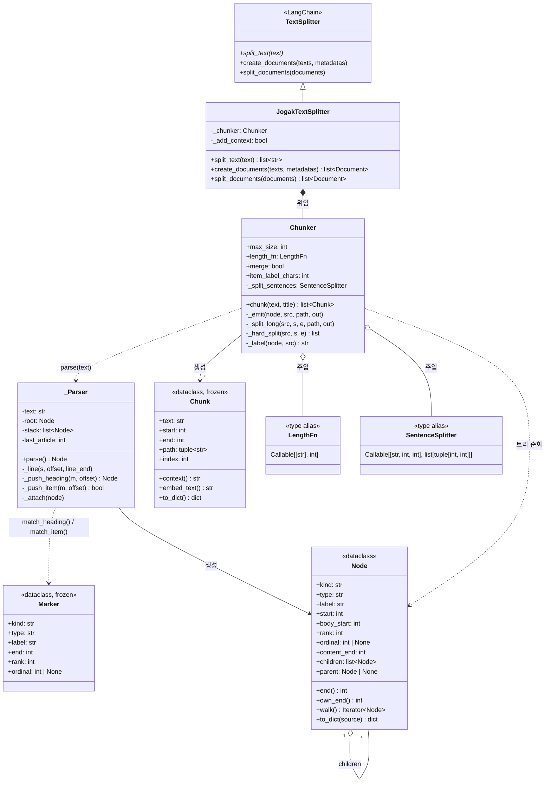
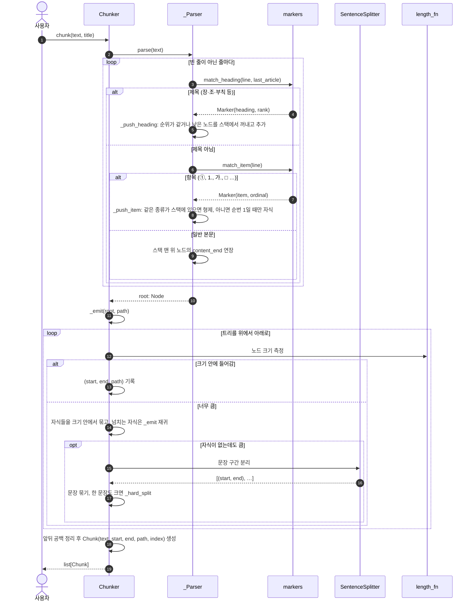
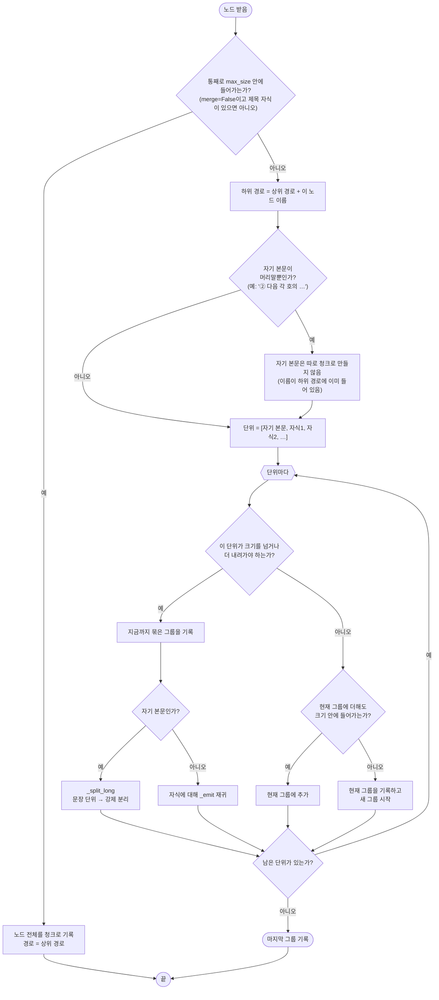
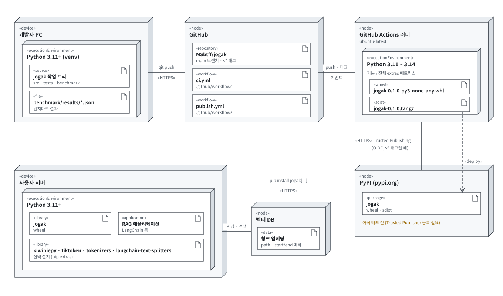

# jogak 아키텍처

jogak은 세 단계의 계층으로 이루어져 있습니다. **줄 머리 표시 인식(markers) → 구조 트리(parser) → 크기 맞춰 자르기(chunker)** 순서이고, 의존은 위에서 아래로 한 방향으로만 흐릅니다. 외부 라이브러리는 모두 바깥쪽 끝에 붙어 있고 선택 설치입니다.

컴포넌트·배치 다이어그램은 UML 표기(컴포넌트 아이콘, 제공·요구 인터페이스, 3차원 노드, 산출물)를 그대로 쓰기 위해 SVG로 그렸습니다. 클래스·시퀀스·활동 다이어그램은 [Mermaid](https://mermaid.js.org/)로 작성해서 GitHub에서 바로 그려집니다.

## 1. 컴포넌트 다이어그램

- **바깥으로 제공하는 인터페이스는 세 가지입니다** (위쪽 원 기호): `chunk() · parse()`(Python API), `TextSplitter`(LangChain), `jogak` CLI.
- **`chunker`가 요구하는 인터페이스는 두 가지입니다.** `SentenceSplitter`와 `LengthFn`이고, 각각 `sentences`와 `length` 컴포넌트가 제공합니다. 원과 반원이 맞물린 기호가 이 조립 연결입니다. 두 인터페이스는 함수 타입이라 사용자가 직접 만든 구현으로 바꿔 끼울 수 있습니다.
- **의존은 위에서 아래로만 흐릅니다** (`chunker → parser → markers`). `markers`는 정규식만 알고, `parser`는 크기 개념을 모르고, `chunker`는 표기 규칙을 모릅니다.
- **핵심 계층은 표준 라이브러리만 씁니다.** «library» 컴포넌트는 extras(`jogak[kiwi]` 등)로 선택 설치합니다.
  - `sentences`와 `length`는 해당 함수를 부를 때만 라이브러리를 import합니다.
  - `langchain`은 `TextSplitter`를 상속해야 해서 모듈을 import할 때 LangChain이 필요합니다. 그래서 `__init__`에 넣지 않았고, `from jogak.langchain import JogakTextSplitter`로 따로 import합니다.

## 2. 클래스 다이어그램

| 타입 | 역할 | 특징 |
|---|---|---|
| `Marker` | 한 줄 맨 앞에서 찾은 구조 표시 | 불변. 앞뒤 줄을 모릅니다. |
| `Node` | 구조 트리의 노드 | 원문 텍스트를 복사하지 않고 위치만 가집니다. `end`와 `own_end`는 자식에서 계산합니다. |
| `_Parser` | 줄을 읽으며 스택으로 트리를 만듦 | 내부 클래스. 바깥에서는 `parse()` 함수로 씁니다. |
| `Chunker` | 트리를 따라 자르기 | 알고리즘은 고정하고, 크기 측정과 문장 분리만 함수로 주입받습니다 (전략 패턴). |
| `Chunk` | 결과 | 불변. 항상 `text == source[start:end]`입니다. 경로는 본문에 섞지 않고 `path`로 따로 둡니다. |
| `JogakTextSplitter` | LangChain 어댑터 | `TextSplitter` 규약에 맞춰 `Chunker`에 위임합니다. |

## 3. 시퀀스 다이어그램: `Chunker.chunk()`

## 4. 활동 다이어그램: 노드 하나를 처리하는 `_emit`

## 5. 배치 다이어그램

- **개발 흐름:** 개발자 PC에서 `git push`하면 GitHub Actions 러너가 Python 3.11~3.14 × (기본 / 전체 extras) 매트릭스로 테스트하고 wheel을 빌드합니다.
- **배포 흐름:** `v*` 태그를 push하면 `publish.yml`이 태그와 `__version__`이 일치하는지 확인합니다. 그다음 Trusted Publishing(OIDC, API 토큰 없음)으로 wheel과 sdist를 PyPI에 올립니다. 아직 PyPI에는 배포하지 않았습니다.
- **사용 흐름:** 사용자 서버의 Python 환경에 `pip install jogak[...]`로 설치하고, RAG 애플리케이션이 청크를 임베딩해서 벡터 DB에 저장합니다. 이때 `path`와 `start/end`를 메타데이터로 함께 저장합니다.
- **패키지에 들어가는 것:** wheel에는 `src/jogak`만 들어갑니다. 벤치마크와 무거운 의존성(sentence-transformers 등)은 사용자 설치에 영향을 주지 않습니다.

## 다이어그램 수정하기

- 컴포넌트·배치 다이어그램은 [`uml/draw.py`](uml/draw.py)로 그린 SVG입니다. 표준 라이브러리만 쓰며, 좌표와 이름을 고친 뒤 `python docs/uml/draw.py`를 실행하면 다시 만들어집니다.
- 클래스·시퀀스·활동 다이어그램은 이 문서 안의 Mermaid 코드를 직접 고치면 됩니다.
