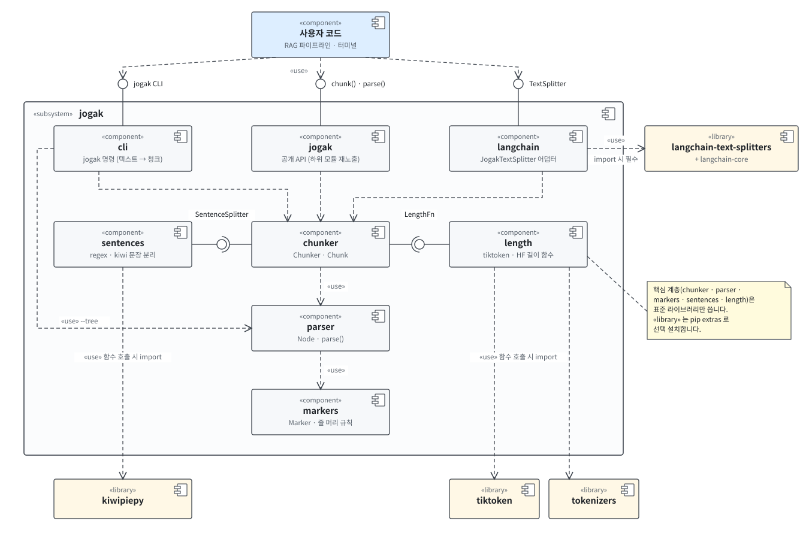
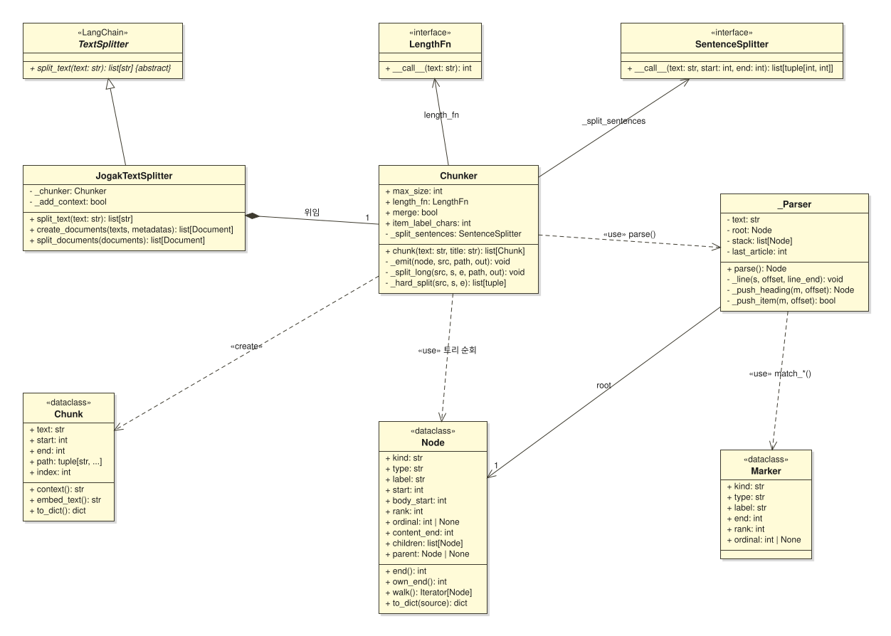
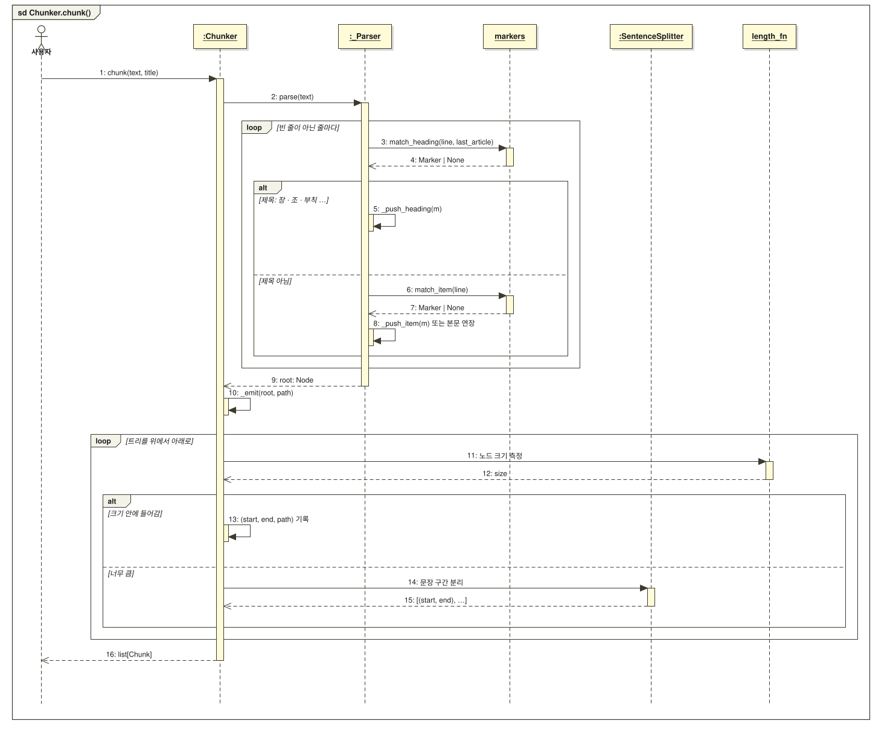
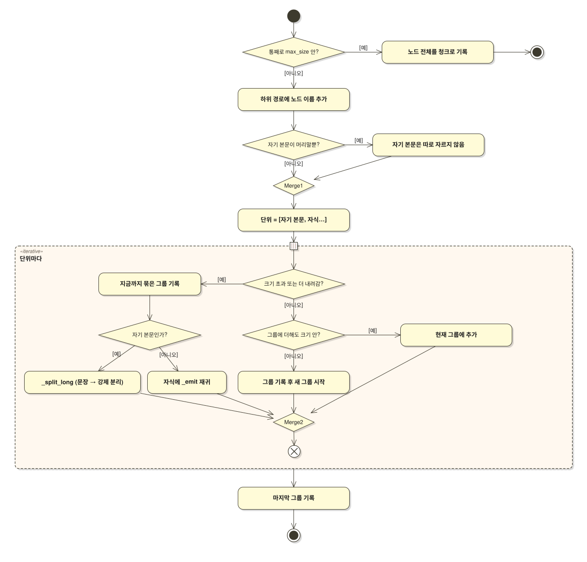

# jogak 아키텍처

jogak은 세 단계의 계층으로 이루어져 있습니다. **줄 머리 표시 인식(markers) → 구조 트리(parser) → 크기 맞춰 자르기(chunker)** 순서이고, 의존은 위에서 아래로 한 방향으로만 흐릅니다. 외부 라이브러리는 모두 바깥쪽 끝에 붙어 있고 선택 설치입니다.

아래 다이어그램 다섯 개는 모두 UML Studio로 그렸습니다. 원본 프로젝트 파일은 [`uml/jogak.uml-studio.json`](uml/jogak.uml-studio.json)입니다.

## 1. 컴포넌트 다이어그램

- **바깥으로 제공하는 인터페이스는 세 가지입니다** (위쪽 원 기호): `CLI`, `Python API`(`chunk()` · `parse()`), LangChain `TextSplitter`.
- **`chunker`가 요구하는 인터페이스는 두 가지입니다.** `SentenceSplitter`와 `LengthFn`이고, 각각 `sentences`와 `length` 컴포넌트가 제공합니다. 두 인터페이스는 함수 타입이라 사용자가 직접 만든 구현으로 바꿔 끼울 수 있습니다.
- **의존은 위에서 아래로만 흐릅니다** (`chunker → parser → markers`). `markers`는 정규식만 알고, `parser`는 크기 개념을 모르고, `chunker`는 표기 규칙을 모릅니다.
- **핵심 계층은 표준 라이브러리만 씁니다.** «library» 컴포넌트는 extras(`jogak[kiwi]` 등)로 선택 설치합니다.
  - `sentences`와 `length`는 해당 함수를 부를 때만 라이브러리를 import합니다.
  - `langchain`은 `TextSplitter`를 상속해야 해서 모듈을 import할 때 LangChain이 필요합니다. 그래서 `__init__`에 넣지 않았고, `from jogak.langchain import JogakTextSplitter`로 따로 import합니다.

## 2. 클래스 다이어그램

| 타입 | 역할 | 특징 |
|---|---|---|
| `Marker` | 한 줄 맨 앞에서 찾은 구조 표시 | 불변. 앞뒤 줄을 모릅니다. |
| `Node` | 구조 트리의 노드 | 원문 텍스트를 복사하지 않고 위치만 가집니다. `end`와 `own_end`는 자식에서 계산합니다. |
| `_Parser` | 줄을 읽으며 스택으로 트리를 만듦 | 내부 클래스. 바깥에서는 `parse()` 함수로 씁니다. |
| `Chunker` | 트리를 따라 자르기 | 알고리즘은 고정하고, 크기 측정과 문장 분리만 함수로 주입받습니다 (전략 패턴). |
| `Chunk` | 결과 | 불변. 항상 `text == source[start:end]`입니다. 경로는 본문에 섞지 않고 `path`로 따로 둡니다. |
| `JogakTextSplitter` | LangChain 어댑터 | `TextSplitter` 규약에 맞춰 `Chunker`에 위임합니다. |

`LengthFn`과 `SentenceSplitter`는 코드에서는 `Callable` 타입 별칭이지만, 바꿔 끼울 수 있는 계약이라는 점을 드러내려고 인터페이스로 그렸습니다.

## 3. 시퀀스 다이어그램: `Chunker.chunk()`

- **파싱 (1–9):** `_Parser`가 빈 줄이 아닌 줄마다 `markers`에 제목인지 먼저 묻고, 아니면 항목인지 묻습니다. 제목이면 순위가 같거나 낮은 노드를 스택에서 꺼낸 뒤 추가합니다. 항목이면 같은 종류가 스택에 있을 때 형제로, 아니면 순번이 1일 때만 자식으로 붙입니다. 둘 다 아니면 스택 맨 위 노드의 본문을 늘립니다.
- **자르기 (10–15):** `Chunker`가 트리를 위에서 아래로 내려가며 노드 크기를 잽니다. 크기 안에 들어가면 그대로 기록하고, 너무 크면 자식으로 내려가거나 자기 본문을 문장 단위로 나눕니다. 한 문장도 크면 `_hard_split`으로 강제로 자릅니다.
- **결과 (16):** 앞뒤 공백을 정리한 뒤 `Chunk(text, start, end, path, index)` 목록을 돌려줍니다.

## 4. 활동 다이어그램: 노드 하나를 처리하는 `_emit`

- `merge=False`이고 제목 자식이 있으면 맨 위 판단은 크기와 상관없이 "아니오"입니다.
- 자기 본문이 머리말뿐이면(예: "② 다음 각 호의 …") 따로 청크로 만들지 않습니다. 이름이 하위 경로에 이미 들어 있기 때문입니다.
- «iterative» 확장 영역은 단위(자기 본문, 자식1, 자식2, …)를 하나씩 순서대로 처리한다는 뜻입니다. 크기 안에 들어가는 단위는 현재 그룹에 모으고, 넘치는 단위는 따로 내려 보냅니다.

## 5. 배치 다이어그램

- **개발 흐름:** 개발자 PC에서 `git push`하면 GitHub Actions 러너가 Python 3.11~3.14 × (기본 / 전체 extras) 매트릭스로 테스트하고 wheel을 빌드합니다.
- **배포 흐름:** `v*` 태그를 push하면 `publish.yml`이 태그와 `__version__`이 일치하는지 확인합니다. 그다음 Trusted Publishing(OIDC, API 토큰 없음)으로 wheel과 sdist를 PyPI에 올립니다. 아직 PyPI에는 배포하지 않았습니다.
- **사용 흐름:** 사용자 서버의 Python 환경에 `pip install jogak[...]`로 설치하고, RAG 애플리케이션이 청크를 임베딩해서 벡터 DB에 저장합니다. 이때 `path`와 `start/end`를 메타데이터로 함께 저장합니다.
- **패키지에 들어가는 것:** wheel에는 `src/jogak`만 들어갑니다. 벤치마크와 무거운 의존성(sentence-transformers 등)은 사용자 설치에 영향을 주지 않습니다.

## 다이어그램 수정하기

1. UML Studio 도구 막대의 **Open** 버튼으로 [`uml/jogak.uml-studio.json`](uml/jogak.uml-studio.json)을 엽니다.
2. 다이어그램을 고친 뒤 **Save** 버튼으로 같은 파일 이름으로 저장합니다.
3. 바꾼 다이어그램마다 **SVG** 버튼으로 내보내서 `docs/uml/` 아래 같은 이름(`component.svg`, `class.svg`, `sequence.svg`, `activity.svg`, `deployment.svg`)으로 덮어씁니다.
